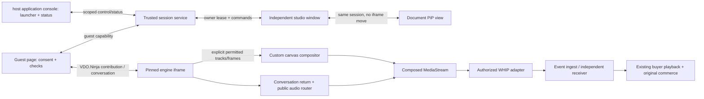

# TRD — media, authority and window ownership

## Selected architecture



This is a proposed design, not an observed host application deployment. The trusted service may be a separately approved prototype service. Its laboratory implementation and real platform authorization are different acceptance layers.

## Ownership invariants

- The independent studio owns one engine, one compositor/audio router and one outgoing publisher. The console is a control/status client and may reload without terminating the owner.
- Use a server-arbitrated owner lease, not just a `window.open` name or localStorage lock. Local window naming/BroadcastChannel can discover/focus a view but does not prevent a second browser from publishing.
- PiP is a view of that studio/session. Do not move a live iframe, recreate the studio root with another set of capture hooks, or clone the media engine into PiP.
- Store resource ownership explicitly. View cleanup removes its listeners/UI; only session finalization stops owned tracks/audio/WHIP. No cross-session `stopAllTracks` global.
- A full studio-window reload can terminate/recover its media session; a console reload must not. PiP is tied to its studio opener and closes on opener destruction/navigation. Normal stop and crash/lease expiry are separately specified.

## Orthogonal state machines

Use discriminated state and identifiers rather than a loose collection of `isReady/isLive/isConnected` booleans.

| Domain | States / transitions | Guard |
|---|---|---|
| Session owner | idle → acquiring → owned → ending → ended; acquiring/owned → fault | Trusted event/host authorization and exclusive lease |
| Guest | absent → invited → checking → backstage → admitted → removed/left; interrupted → checking/backstage | Single guest lease and generation; admission never follows automatically from reconnect |
| Output | idle → resolving → negotiating → publishing → stopping → stopped; negotiation/publishing → retrying/fault | Current event config, usable composed stream, one publisher |
| Floating view | ordinary → opening → floating → returning → ordinary; unavailable/denied → ordinary | Top-level user gesture and capability check; no capture/session recreation |
| Event | canonical backend state, observed by adapter | Ended/cancelled/ineligible state prevents new admission/publishing; no implicit Start/End mutations |

Ready means usable tracks plus contribution transport. Publishing means sender transport and media progress, not audience success. Audience-confirmed requires independent observation. On air means guest included in the outgoing program after a committed program revision; public event visibility remains separate.

## Proposed service boundary

Operation names are abstract and **not existing host application/GraphQL APIs**:

```text
authorizeStudio(eventId, hostIdentity) -> Result<HostCapability, Denied>
acquireOwner(eventId, hostCapability) -> Result<OwnerLease, AlreadyOwned | Denied>
renewOwner(ownerLease) -> Result<OwnerLease, Expired | Revoked>
createGuestInvite(ownerLease) -> { inviteCapability, expiresAt }   // <=15 min
redeemInvite(inviteCapability) -> Result<GuestLease, Expired | Reused | Full | Denied>
revokeGuest(ownerLease, guestId, generation) -> acknowledgement
applyProgramCommand(ownerLease, command) -> Result<ProgramAcknowledgement, Rejected>
resolvePublishConfig(ownerLease, eventId) -> Result<PublishConfig, Denied | Unavailable>
releaseOwner(ownerLease) -> acknowledgement
```

Capabilities are opaque/scoped/expiring. Keep the studio and guest identities separate. A director room password does not grant seller authorization. Single redemption and capacity checks must be atomic at the trusted boundary. Renewed guest media uses a new connection generation and returns backstage. Revocation wins over a pending older admission.

Commands include `requestId`, `eventId`, `sessionId`, `guestId` where relevant, `generation`, monotonic `sequence`, expected program revision and a scoped capability reference. Reply with the accepted/rejected request ID, actual revision/state, and safe error code. Never echo tokens. Reject duplicate conflicting IDs, stale sequences, wrong owner/event/session/generation and unknown schema versions. Retries of the same idempotent request return its original result.

## Media adapter and origins

Prefer a studio and pinned engine served from the **same exact origin** for explicit access to decoded video/MediaStreams. The console may interact with a separate studio origin via a narrow authenticated protocol, without reading its media DOM. A hosted cross-origin VDO.Ninja iframe can be controlled with messages, but its video DOM is not readable by the parent. An explicit frame/audio bridge is an alternative only after its deployment/browser/throughput behavior is demonstrated.

The engine adapter must identify both origin and source window before accepting events, correlate callbacks and time out missing replies. Select the smallest delegated iframe permissions needed for this capture path. Inspect actual HTTPS/CSP/Permissions-Policy behavior; an `allow` attribute does not override a restrictive parent policy. Pin source rather than trusting an unversioned alpha build.

No hard-coded host/guest media source selection or fake `connected` acknowledgements. Engine load, permission grant, usable track, transport and actual program progress are distinct events.

## Program and audio routing

Canvas output is fixed at 720x1280; CSS preview size and PiP resizing do not change encoder dimensions. Keep draw ordering/crop rules deterministic per layout. Camera-off and disconnected sources render deliberate placeholders, not a stale last frame indefinitely. Do not reset canvas width/height every frame or every UI resize.

Create one program video track via canvas capture and one explicit outgoing audio track from the program audio graph. The publisher accepts this composed stream rather than calling its own `getUserMedia`. Do not concatenate two audio tracks and assume the ingest mixes them.

```text
host microphone -----> guest conversational return (without guest mic)
guest microphone ----> host conversational return (without host mic)
host microphone -----> public program audio
guest microphone --[admitted && program-unmuted && current generation]--> public program audio
delayed buyer player ----------------------------------------------X--> call/program
private text/notification output -----------------------------------X--> public program
```

Mute/exclusion affects the proper bus. Guest self mute may physically stop/mute a track; host program mute does not authorize remote capture. Do not open a second host mic inside a second iframe/publisher. Initial private cues are text; private spoken host cues would require an additional explicit audio-routing feature outside this baseline.

Admission commits a revision at the compositor/audio router boundary; then acknowledge it. Removal first closes public audio/video gates, then revokes/disconnects the contribution. Every frame/audio gate validates the active generation so a late callback cannot reattach a removed source.

## Frame scheduling and PiP

Keep frame production independent of console tab rendering. Hidden `requestAnimationFrame`/iframe behavior varies; a live peer connection is not proof of unthrottled canvas output. Choose a visible-window scheduler, supported worker/frame pipeline or another measured solution. The contract tests the decoded receiver and moving source, not just frame counters generated by the app.

From the studio's top-level click handler, request Document PiP, attach the lightweight controls/preview/render surface, copy/apply styles and manage focus. The engine iframe stays fixed. If a canvas/video surface moves, preserve its identity/stream and explicitly manage paint scheduling; do not blindly append a whole iframe-containing React tree into another document.

On PiP `pagehide` or Return studio, restore the view/render owner before losing its window and continue the same publisher. If unsupported/denied, retain the ordinary studio. Do not hide the only producing surface and assume it keeps painting. Document PiP cannot outlive its opener; an ordinary studio window is the independent lifetime boundary.

## WHIP and current host application ingest

The [integration map](integration-map.md) describes responsibilities, not existing source or APIs. The current publish authorization/session API must be established in the target application. Implement and document that adapter; select WHIP explicitly and use the latest event-scoped configuration. URLs for other protocols are not alternatives to guess at.

Use the selected WHIP client's proper offer/answer, ICE and session-resource handling, including explicit stop/DELETE where supported by the actual RFC-compliant ingest. [RFC 9725](https://www.rfc-editor.org/rfc/rfc9725.html) is the protocol reference. Real endpoint/codec/CORS/auth/ICE compatibility must be demonstrated. SDP or a successful POST alone is not media proof.

Keep acquired configuration in memory, never guest payloads or public/persistent stores. Authentication failure/endpoint change invalidates configuration and triggers fresh authorized resolution with bounded retries. No unbounded retry loop, cross-event retargeting or duplicated publisher. Start/Stop Publishing must not call existing event Start/End mutations automatically.

## Recovery, diagnostics and cleanup

Use the thresholds and failure defaults in [decisions](decisions-and-assumptions.md), with program/command timestamps in a common or bounded-uncertainty timebase. Distinguish expected fault intervals from normal performance windows before analysis.

Provide an opt-in read-only diagnostic snapshot in test environments. Required fields: schema version, event/session/engine IDs, owner state, engine generation, guest ID/generation/state, program revision/layout, publisher session/state, track counts, rendered/encoded frame progress, bytes sent, frame queue depth and safe error codes. Include timestamps, no capabilities/tokens/SDP. Proposed test API: `window.__COHOST_DIAGNOSTICS__.snapshot()`; it must not mutate the system or replace independent evidence.

Final cleanup order: close public gates; mark session ending; notify guest; stop publisher and attempt WHIP resource deletion; stop owned tracks; close audio contexts; cancel scheduling/workers; close peer connections; remove listeners/channels; release lease; clear in-memory secrets; confirm stopped. Recovery/close is idempotent. Losing only a floating view must not run final cleanup.

## Sources and limits

Product basis: [PRD](prd.md) and [design exploration](../notes/design-handoff.md). Proposed integration responsibilities: [integration map](integration-map.md). Public browser/VDO.Ninja references: [studio research](../notes/studio-and-popout.md). [Playwright configuration](https://playwright.dev/docs/test-configuration) informs the isolated validation runner. Proposed interfaces and numeric budgets are engineering defaults. No running media implementation is established by this TRD.


## Public scope and references

This is a proposed engineering contract, not an approved product specification or a claim about a deployed system. Internal source maps, source revisions, private research, service locations and run artifacts are intentionally not distributed. See [public studio research](../notes/studio-and-popout.md), [integration responsibilities](integration-map.md), and [open review findings](review-findings.md).

Return to [package overview](README.md).
